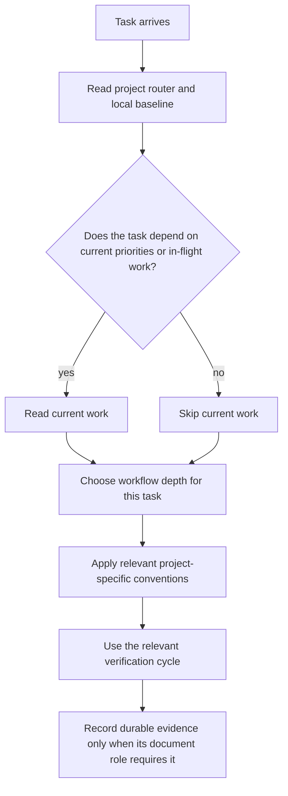

# Engineering Runtime Agents Routing v1.1

Shared routing algorithm for app, game, runtime, and code-heavy projects.

This file decides **how to choose a workflow**, not what the project is currently building. Current work belongs in the project's `docs/reference/execution/current-work.md` or equivalent.

## Core Flow

`current-work` is a conditional state surface, not universal startup context.
Likewise, AI-in-the-Loop applies when implementation or runtime verification
needs it; a documentation-only or read-only routing task does not load that
policy by default.

## Keep It Small

Use this router only to pick depth and workflow. Do not use it as a project roadmap.

## Three-Stage Delivery

<!-- PGS-DELIVERY:THREE-STAGE -->

1. **Edit locally.** Run relevant local checks with isolated data and mocks; do
   not start paid external validation during ordinary development.
2. **Verify, then push — related checks only.** For the complete outgoing change
   range against the target base, tooling selects checks automatically from
   changed paths and dependency relationships, not a hand-picked test list:
   formatting, lint, type checks and unit tests for affected packages, plus the
   browser tests affected by the change. Documentation-only changes run their
   relevant document/governance checks, not unrelated engineering suites.
   Do not run repository-wide full verification, the entire browser suite or
   the entire timing suite before an ordinary push or merely to finish a task.
   Any failing related check blocks the push. Ordinary push/PR saves code; it
   must not start hosted Actions or Vercel preview/production deployments.
3. **Release explicitly — full suite for the release candidate.** Only before
   an authorized release, run all applicable unit tests, browser tests, timing
   tests and full verification once for that exact candidate. Any failure or
   missing required evidence blocks release. Keep existing release/security
   gates and production runtime monitoring. Check credentials, environment and
   budget before cloud acceptance/publication; publish only the tested source
   or artifact. Reuse results only while source, dependencies, relevant
   environment and retained artifacts remain valid.

Dependency-based browser selection (for example Playwright
`--only-changed=<ref>` where supported) sees changed tests and their imports;
it does not infer application-source-to-browser-test coverage when tests do not
import the application. Each project must therefore supply a maintained source
path-to-test mapping or a fixed smoke set, used by the selector, and document
its blind spots. Missing selection evidence is a gap to report, not proof that
zero tests cover the change and not a reason to silently run the full suite.

Never use `--no-verify`, bypass hooks, or rerun failures merely to obtain green.
Investigate failures with a smaller reproducer and retain the original result;
rerun only after a relevant fix or new evidence. Do not add nightly full runs:
full suites belong only to pre-release validation. Delivery reports name the
selected related checks, their selection basis, results and coverage limits.
An explicitly requested preview/staging acceptance belongs to stage 3. An edit
or push request stops at stage 2; do not relabel routine saves as releases.
These rules govern engineering validation, not separately authorized creative
production, and do not introduce engineering tests for unrelated prose.

Reuse project commands and project-owned hooks for these gates; do not add a CI service or profile.

## Project-Specific Conventions

Use existing commands and actual project constraints in `AGENTS.md` or
`docs/policy/best-practice-for-this-project.md`. A project may document special
lanes, but common task categories do not require a separate lane profile.

Planning, research and testing should match the change's risk. Use relevant
checks and required delivery gates; expand or repeat only for related changes,
failures or unresolved questions. Routine work does not require new Spec, Plan,
ADR or proof documents. Keep durable decisions and handoff evidence in their
existing document roles.

## Host Compatibility Boundary

Follow the Project AI Host SSOT in `docs/governance/ssot-v1.1.md`. Host-specific
runtime settings must not create a second project router or skill tree.
